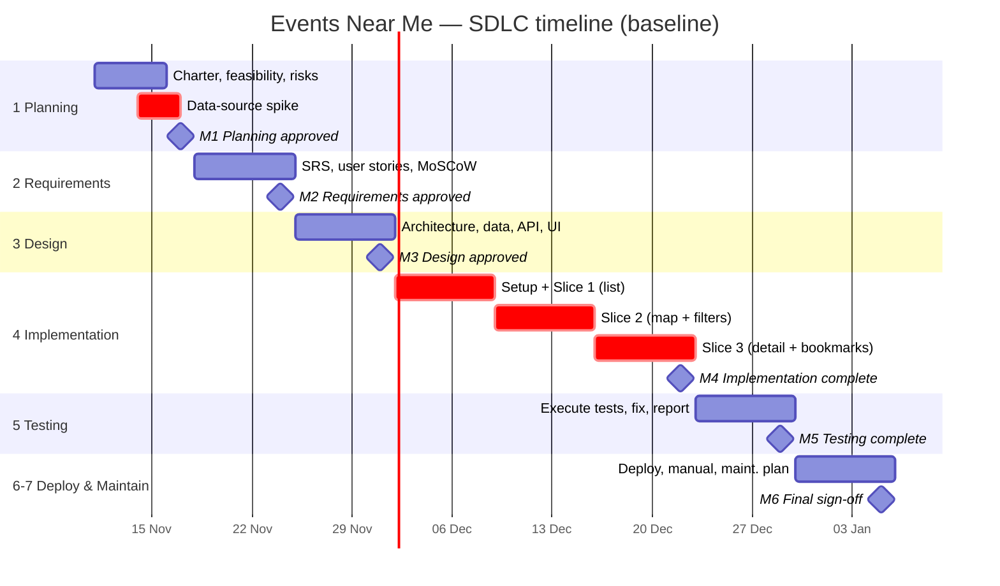
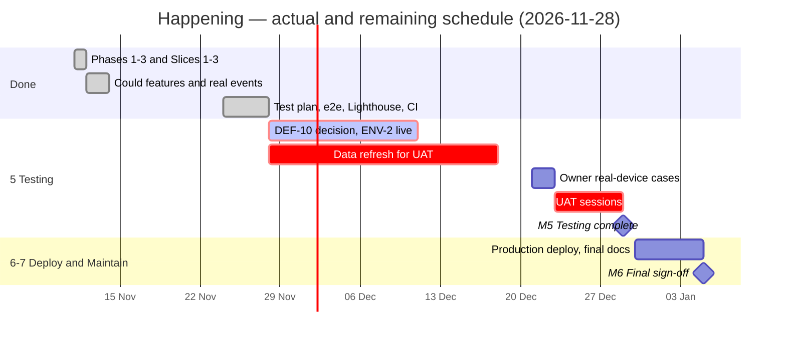

# Timeline & Milestones — Events Near Me

| Field | Value |
|---|---|
| Phase | 1 — Planning |
| Product name | Written as "Events Near Me"; the product is now **Happening** (CR-01). Title kept as approved. |
| Version | 1.0 — approved 2026-11-11 · 1.1 — §1a "actual vs plan" and §3b remaining-schedule Gantt added 2026-11-28 (baseline unchanged) |
| Date | 2026-11-11 |
| Duration | 8 weeks, ~10 h/week (~80 h) — `ASSUMPTION` A-2 |

> **What is a project timeline?** It breaks the work into phases with dates and **milestones**
> (points where something is finished and approved). A **Gantt chart** shows each phase as a bar
> over time so you can see overlaps and the critical path at a glance.

## 1. Milestones

| ID | Milestone | Target date | Exit criterion (definition of done) |
|---|---|---|---|
| M1 | Planning approved | ✅ Wed 2026-11-11 (early) | Charter, feasibility, risks, timeline approved; data-source spike moved to start of Phase 2 |
| M2 | Requirements approved | ✅ Wed 2026-11-11 (early) | SRS with FR/NFR IDs, user stories, MoSCoW, MVP defined; traceability matrix started |
| M3 | Design approved | ✅ Wed 2026-11-11 (early) | Architecture, data model, API spec, UI/UX, security docs approved |
| M4a | Slice 1 working | ✅ Wed 2026-11-11 (early, PR hiiew/events-near-me#1) | Location → list of nearby events (deployed preview) |
| M4b | Slice 2 working | ✅ Wed 2026-11-11 (early) | Map view + filters |
| M4c | Implementation complete | ✅ Wed 2026-11-11 (early; FR-26 deferred, CR-03) | All Must-have requirements built; dev log up to date |
| M5 | Testing complete | Tue 2026-12-29 | Test cases executed; test report; all Must-haves have passing tests |
| M6 | Deployed + docs | Tue 2027-01-05 | Live on Vercel (**early deploy to `happening-kl.vercel.app` decided 2026-11-11**); deployment guide, user manual, maintenance plan; final sign-off |
| — | Real events | ✅ Fri 2026-11-13 (early; target was Sun 2026-12-06) | ≥20 real KL events replace the SAMPLE data (owner sends ~5/week) |
| — | UAT sessions | 23–29 Dec 2026 | Owner + 3 anonymous classmates (Tester A–C), ~20 min each |

*Week 4–6 fall over the holiday period — adjust if you plan time off (that's what the buffer is for).*

## 1a. Actual vs plan (updated 2026-11-28)

> The table above and the weekly plan / Gantt below are the **approved baseline** and are kept as they
> were. This section compares them with what really happened (dev-log, test report, git history) and
> lists the remaining schedule with what each step depends on.

**Done**

| ID | Milestone | Baseline date | Actual date | Note |
|---|---|---|---|---|
| M1 | Planning approved | Tue 17 Nov | ✅ Wed 11 Nov | 6 days early |
| M2 | Requirements approved | Tue 24 Nov | ✅ Wed 11 Nov | 13 days early |
| M3 | Design approved | Tue 1 Dec | ✅ Wed 11 Nov | 20 days early |
| M4a | Slice 1 working | Tue 8 Dec (end of week 4) | ✅ Wed 11 Nov | PR #1 |
| M4b | Slice 2 working | Tue 15 Dec (end of week 5) | ✅ Wed 11 Nov | |
| M4c | Implementation complete | Tue 22 Dec | ✅ Wed 11 Nov | Musts built; FR-26 deferred (CR-03). Could features FR-23, FR-33 – FR-41 added 12–13 Nov via CR-04 – CR-12; FR-03 fix 24 Nov (CR-14) |
| — | Real events (≥ 20) | Sun 6 Dec | ✅ Fri 13 Nov | 46 real entries (41 Klang Valley + 5 Kota Kinabalu); sample data removed |
| — | Phase 5 started | Wed 23 Dec | ✅ Tue 24 Nov | Test plan, test cases, Playwright suites, Lighthouse on ENV-1 |
| — | Phase 6 started (early deploy prep) | Wed 30 Dec | ✅ Tue 24 Nov | CI, Dependabot, deployment guide, release checklist; user manual 27 Nov |
| — | Phase 7 drafted | Wed 30 Dec | ✅ Fri 27 Nov | Maintenance plan, backlog, dependency-update log |

**Remaining (dates from the baseline and test-plan §7; none moved)**

| When | Step | Depends on (owner items in **bold**) | Status 2026-11-28 |
|---|---|---|---|
| By Fri 11 Dec | Defect fixes merged and re-tested; ENV-2 (production URL) confirmed and smoke checks S-1 – S-13 run | **Owner decision on DEF-10** (fix or CR); **owner confirms the production URL and runs the smoke checks** (deployment guide §3–4) | Not started — waiting on owner |
| By Fri 18 Dec | Curated data refreshed for the UAT window (E-6, RT-01): ≥ 10 Klang Valley events dated 23 Dec onwards | **Owner sends late-December event pages**; events-curator adds them; ideally after **OT-1 (Ticket2u terms)** is answered, because most data comes from Ticket2u | Not started — latest event today is Sat 19 Dec |
| Mon 21 – Tue 22 Dec | Owner's real-device and manual cases (TC-35, TC-48, TC-51, TC-62 screen reader, TC-64, TC-66) | Production URL live; owner's Android phone and laptop; no iPhone available (iOS gap) | Not started |
| Wed 23 – Tue 29 Dec (avoid 24–25) | UAT: owner + Testers A–C, ~20 min each, in person (`uat-script.md`) | Refreshed data passes the script's data check; production URL + QR code; testers booked | Script ready (v1.1); sessions not booked in the docs |
| **Tue 29 Dec — M5** | Testing complete: test report v1.0, every Must ✅, no open S1/S2 defect | All of the above; 12 Must rows still open (see status report) | **At risk** — not late, but every remaining step waits on an owner action |
| **Tue 5 Jan 2027 — M6** | Deployed + docs, final sign-off | M5; production deploy; deployment guide, user manual and maintenance plan approved by the owner | Docs drafted; approvals and live URL pending |

## 2. Weekly plan (original baseline)

> Kept as approved on 2026-11-11. Phases 1–4 finished early (see the milestones table); the
> remaining dates for M5 and M6 still apply.

| Week | Dates | Phase | Main activities | Hours |
|---|---|---|---|---|
| 1 | 11 – 17 Nov | 1 Planning | Charter, feasibility, risks, timeline, **data-source spike** | 10 |
| 2 | 18 – 24 Nov | 2 Requirements | SRS, user stories, MoSCoW, traceability matrix | 10 |
| 3 | 25 Nov – 1 Dec | 3 Design | Architecture, data model, API spec, wireframes, security/privacy | 10 |
| 4 | 2 – 8 Dec | 4 Implementation | Project setup, linting, CI, `.env.example`; **Slice 1**: location → event list | 10 |
| 5 | 9 – 15 Dec | 4 Implementation | **Slice 2**: map view, filters | 10 |
| 6 | 16 – 22 Dec | 4 Implementation | **Slice 3**: event detail, bookmarks, remaining Musts; unit tests alongside | 10 |
| 7 | 23 – 29 Dec | 5 Testing | Test plan execution, bug fixing, accessibility check, test report | 10 |
| 8 | 30 Dec – 5 Jan | 6 Deployment + 7 Maintenance | Production deploy, user manual, maintenance plan, final review | 10 |

The **buffer** (~6 h) is spread inside weeks 6–8; if Phase 4 overruns, "Should" items move to the
maintenance backlog rather than extending the deadline.

## 3. Gantt chart (baseline, as approved 2026-11-11)

## 3b. Gantt chart — actual and remaining (updated 2026-11-28)

Phases 1–4 all finished on 11 Nov, so their bars collapse to a day; the end dates M5 and M6 are unchanged.
Red (critical) bars are the steps that wait on the owner.

## 4. Critical path

Data-source spike → Requirements → Design → Slices 1–3 → Testing → Deployment.
Every phase depends on the previous one being approved, so a delay anywhere pushes the end date.
The spike is on the critical path because **if KL data is too thin, requirements must change.**

**Critical path now (updated 2026-11-28):** owner decisions (DEF-10, OT-1 Ticket2u terms) → production URL +
smoke checks → data refresh by 18 Dec → UAT 23–29 Dec → M5 → production deploy → M6. Claude's remaining work
(DEF-10 fix if chosen, test-report updates) is small; the path is set by owner actions.
