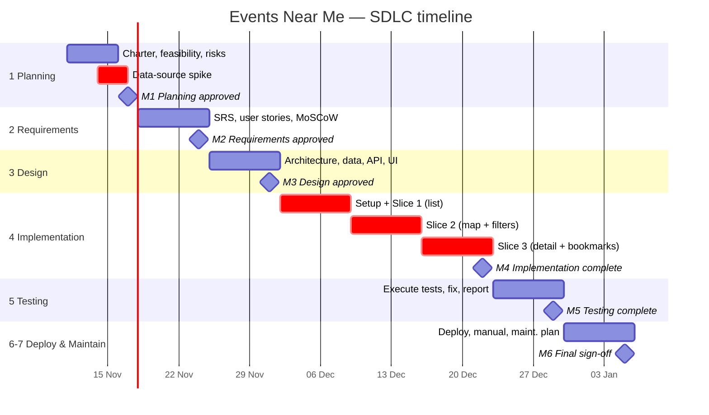

# Timeline & Milestones — Events Near Me

| Field | Value |
|---|---|
| Phase | 1 — Planning |
| Version | 1.0 (draft for approval) |
| Date | 2026-11-11 |
| Duration | 8 weeks, ~10 h/week (~80 h) — `ASSUMPTION` A-2 |

> **What is a project timeline?** It breaks the work into phases with dates and **milestones**
> (points where something is finished and approved). A **Gantt chart** shows each phase as a bar
> over time so you can see overlaps and the critical path at a glance.

## 1. Milestones

| ID | Milestone | Target date | Exit criterion (definition of done) |
|---|---|---|---|
| M1 | Planning approved | Tue 2026-11-17 | Charter, feasibility, risks, timeline approved; data-source spike done |
| M2 | Requirements approved | Tue 2026-11-24 | SRS with FR/NFR IDs, user stories, MoSCoW, MVP defined; traceability matrix started |
| M3 | Design approved | Tue 2026-12-01 | Architecture, data model, API spec, UI/UX, security docs approved |
| M4a | Slice 1 working | Tue 2026-12-08 | Location → list of nearby events (deployed preview) |
| M4b | Slice 2 working | Tue 2026-12-15 | Map view + filters |
| M4c | Implementation complete | Tue 2026-12-22 | All Must-have requirements built; dev log up to date |
| M5 | Testing complete | Tue 2026-12-29 | Test cases executed; test report; all Must-haves have passing tests |
| M6 | Deployed + docs | Tue 2027-01-05 | Live on Vercel; deployment guide, user manual, maintenance plan; final sign-off |

*Week 4–6 fall over the holiday period — adjust if you plan time off (that's what the buffer is for).*

## 2. Weekly plan

| Week | Dates | Phase | Main activities | Hours |
|---|---|---|---|---|
| 1 | 11 – 17 Nov | 1 Planning | Charter, feasibility, risks, timeline, **data-source spike** | 10 |
| 2 | 18 – 24 Nov | 2 Requirements | SRS, user stories, MoSCoW, traceability matrix | 10 |
| 3 | 25 Nov – 1 Dec | 3 Design | Architecture, data model, API spec, wireframes, security/privacy | 10 |
| 4 | 2 – 8 Dec | 4 Implementation | Project setup, linting, CI, `.env.example`; **Slice 1**: location → event list | 10 |
| 5 | 9 – 15 Dec | 4 Implementation | **Slice 2**: map view, filters | 10 |
| 6 | 16 – 22 Dec | 4 Implementation | **Slice 3**: event detail, bookmarks, remaining Musts; unit tests alongside | 10 |
| 7 | 23 – 29 Dec | 5 Testing | Test plan execution, bug fixing, accessibility check, test report | 10 |
| 8 | 30 Dec – 5 Jan | 6 Deployment + 7 Maintenance | Production deploy, user manual, maintenance plan, final review | 10 |

The **buffer** (~6 h) is spread inside weeks 6–8; if Phase 4 overruns, "Should" items move to the
maintenance backlog rather than extending the deadline.

## 3. Gantt chart

## 4. Critical path

Data-source spike → Requirements → Design → Slices 1–3 → Testing → Deployment.
Every phase depends on the previous one being approved, so a delay anywhere pushes the end date.
The spike is on the critical path because **if KL data is too thin, requirements must change.**
