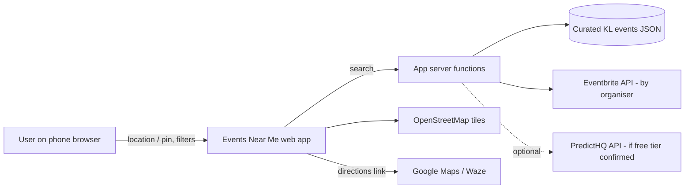

# Software Requirements Specification (SRS) — Events Near Me

| Field | Value |
|---|---|
| Phase | 2 — Requirements |
| Version | 1.0 (draft for approval) |
| Date | 2026-11-11 |
| Standard | Structure based on IEEE 830 / ISO/IEC/IEEE 29148 |

> **What is an SRS?** It is the contract between "what we want" and "what we build". Every
> requirement has an **ID** so design, code and tests can point back to it. A good requirement is
> **specific, testable and unambiguous** — if you can't write a test for it, rewrite it.
> **Functional requirements (FR)** say *what* the system does. **Non-functional requirements (NFR)**
> say *how well* it does it (speed, security, accessibility…).

---

## 1. Introduction

### 1.1 Purpose
Defines the requirements for **Events Near Me**, a mobile-friendly web app that shows upcoming
events near the user in Kuala Lumpur on a list and a map. Audience: the developer, the assessor,
and anyone maintaining the app.

### 1.2 Scope
The app finds events within a chosen radius of the user's location (or a pin they drop), lets them
filter by distance, date, category and price, view details, get directions and bookmark events.
Event data comes from (1) a **curated dataset** of real public KL events maintained by the developer
and (2) **live official APIs** where they have KL coverage, combined through an **adapter layer**.
See project charter §4 for out-of-scope items.

### 1.3 Definitions

| Term | Meaning |
|---|---|
| Event | Something happening at a place and time, e.g. concert, market, workshop |
| Source | Where event data comes from (curated dataset, Eventbrite, …) |
| Adapter | Code that converts one source's data into the app's common `Event` format |
| Curated dataset | A JSON file of real events entered by the developer, each linking to its official page |
| Search point | The location results are measured from: the device's location or a dropped pin |
| MVP | Minimum Viable Product — the Must-have requirements |
| PWA | Progressive Web App — a website that behaves like an installable app |
| MoSCoW | Must / Should / Could / Won't (this time) prioritisation |

### 1.4 References
`docs/01-planning/project-charter.md`, `feasibility.md`, `risk-register.md`, `data-source-spike.md`.

---

## 2. Overall description

### 2.1 Product perspective
A new, standalone web app. It depends on: the browser Geolocation API, OpenStreetMap tiles (via
Leaflet), external event APIs, and free-tier hosting.

### 2.2 User class
| User | Description |
|---|---|
| Visitor (primary) | Student / young adult in the Klang Valley, on a smartphone, wants something to do soon. No account. |
| Maintainer (developer) | Updates the curated dataset and organiser list; manages API keys. Not a separate in-app role. |

### 2.3 Operating environment
Latest two major versions of Chrome (Android) and Safari (iOS); also works on desktop browsers.
Hosted on Vercel (free tier). Times shown in **Malaysia time (Asia/Kuala_Lumpur, UTC+8)**.

### 2.4 Design and implementation constraints
C-1 to C-6 from the charter apply (RM0, ~80 h, official sources only, PDPA, no secrets in repo,
documentation first). Language: **English only**. Currency: **RM**.

### 2.5 Assumptions and dependencies

| ID | Assumption / dependency |
|---|---|
| A-7 | The developer can spend ~30 min/week keeping the curated dataset current (new) |
| A-8 | Eventbrite still offers events-by-organiser access with a free key — **verified 2026-11-11** (spike); source later deferred, CR-03 |
| A-9 | Curated events can be given coordinates by looking up the venue (e.g. on OpenStreetMap) (new) |

---

## 3. Functional requirements

Priority uses MoSCoW. **M** = Must (MVP), **S** = Should, **C** = Could, **W** = Won't this time.

### 3.1 Location

| ID | Requirement | Priority |
|---|---|---|
| FR-01 | The app shall explain why it needs location and then request the device's location using the browser permission prompt. | M |
| FR-02 | If location is denied, unavailable or takes longer than 10 s, the app shall let the user **drop a pin on the map** to set the search point. | M |
| FR-03 | The user shall be able to change the search point at any time by using their location again or moving the pin. | M |

### 3.2 Finding events

| ID | Requirement | Priority |
|---|---|---|
| FR-04 | The app shall show upcoming events within the selected radius of the search point. Default radius: **10 km**. | M |
| FR-05 | The app shall hide events that have already ended. | M |
| FR-06 | The app shall show results in a **list**, sorted by start date (soonest first) by default, with an option to sort by distance. Each item shows title, date/time, venue, distance (km), category and price. | M |
| FR-07 | The app shall show results on a **map** with one marker per event; tapping a marker shows a summary card that opens the event detail. | M |
| FR-08 | The user shall be able to switch between list and map view without losing filters. *(Night Map, DC-01: list and map are shown together on one screen, so no switch is needed; filters apply to both.)* | M |
| FR-09 | Events without coordinates shall appear in the list (labelled "Location on map not available") but not on the map. | M |

### 3.3 Filters

| ID | Requirement | Priority |
|---|---|---|
| FR-10 | **Distance filter**: 2, 5, 10 (default), 25 or 50 km. | M |
| FR-11 | **Date filter**: Today, This weekend, Next 7 days, Next 30 days (default). | M |
| FR-12 | **Category filter** (multi-select): Music, Food & Markets, Arts & Culture, Sports, Workshops & Learning, Tech & Meetups, Nightlife, Other. Default: all. | M |
| FR-13 | **Price filter**: All (default), Free only, or Maximum price in RM. Events with no price listed are shown under "All" only and labelled "Price not listed". | M |
| FR-14 | Filters shall combine (AND) and update results without a full page reload. | M |
| FR-15 | The app shall show a clear empty state when no events match, suggesting a wider radius or date range. | M |
| FR-16 | **Custom date range** picker. | C |
| FR-34 | **"Free this week" quick chip** above the results list: one tap sets the Price filter to Free only and the Date filter to Next 7 days; it shows as active while both are set, and tapping it again resets just those two filters (CR-04). | C |

### 3.4 Event detail and actions

| ID | Requirement | Priority |
|---|---|---|
| FR-17 | The event detail view shall show: title, start (and end if known) date/time in Malaysia time, venue name and address, distance, category, price in RM (or original currency if not RM, or "Price not listed"), description, image (if provided), and the **source name**. | M |
| FR-18 | The detail view shall have a button that opens the **official event / ticket page** in a new tab. | M |
| FR-19 | The detail view shall have a **Directions** button that opens Google Maps or Waze to the venue. | M |
| FR-20 | The user shall be able to **bookmark** and un-bookmark an event; bookmarks are stored **on the device only** and shown on a "Saved" screen. | M |
| FR-21 | Bookmarked events that have ended shall be marked "Ended" on the Saved screen. | S |
| FR-22 | **Share** an event using the phone's share sheet, or copy its link where sharing isn't supported. | S |
| FR-23 | Add an event to the phone's calendar (`.ics` download). | C |

### 3.5 Data sources (adapter layer)

| ID | Requirement | Priority |
|---|---|---|
| FR-24 | The system shall get events from all enabled sources through **adapters** that convert each source's data into one common `Event` format. | M |
| FR-25 | The system shall load events from a **curated dataset** file in the repo. Each curated event must include a link to its official source page. Invalid entries are skipped and reported in the server log. | M |
| FR-26 | The system shall load events from **Eventbrite** for a configured list of KL organisers. | S |
| FR-27 | The system shall load events from **PredictHQ**, only if a free plan is confirmed. | C |
| FR-28 | If one source fails or times out (5 s), the system shall still return results from the other sources and show a small notice "Some sources are unavailable". | M |
| FR-29 | The system shall remove obvious duplicates (same title, same start date, venues within 200 m). | S |
| FR-30 | The system shall cache each source's responses on the server for a configurable time (default 15 min), within the provider's terms. | S |

### 3.6 Privacy, info and app

| ID | Requirement | Priority |
|---|---|---|
| FR-31 | The app shall have a **Privacy** page explaining what location data is used, why, that it isn't stored, and what is saved on the device. | M |
| FR-32 | The app shall show data-source attribution and OpenStreetMap attribution. | M |
| FR-33 | The app shall be **installable** to the home screen (PWA manifest). | C |

### 3.7 Won't have (this time)

| ID | Item | Reason |
|---|---|---|
| W-01 | User accounts / login | Not needed for MVP; adds privacy and security work |
| W-02 | User-submitted events, moderation | Out of scope (charter) |
| W-03 | Push notifications / reminders | Time |
| W-04 | Bahasa Melayu interface | English-only decided 2026-11-11 |
| W-05 | Ticket purchase / payments | Out of scope |
| W-06 | Native app-store apps | PWA chosen |
| W-07 | Scraping-based sources (e.g. SerpApi) | Conflicts with C-3 |
| W-08 | Ticketmaster source | Spike returned 0 KL events; revisit in maintenance |

---

## 4. Non-functional requirements

| ID | Category | Requirement | How it will be verified | Priority |
|---|---|---|---|---|
| NFR-01 | Performance | First results appear within **3 s** of the search point being set, on a simulated "Fast 4G" connection (cached sources). | Browser dev tools throttling; timing log | M |
| NFR-02 | Performance | Lighthouse Performance score **≥ 80** on mobile for the home page. | Lighthouse report | S |
| NFR-03 | Usability / responsive | Fully usable from **360 px** wide screens up to desktop; no horizontal scrolling. | Manual test at 360, 768, 1280 px | M |
| NFR-04 | Usability | A new user can open an event's details within **3 taps** after results appear. | UAT task test | M |
| NFR-05 | Accessibility | Meets **WCAG 2.1 AA** for core screens: contrast ≥ 4.5:1, all controls keyboard- and screen-reader-accessible, tap targets ≥ 44 px. Lighthouse Accessibility **≥ 90**. | Lighthouse + manual check | M |
| NFR-06 | Security | API keys exist only in server environment variables; never sent to the browser or committed. | Code review; secret scan; inspect browser network calls | M |
| NFR-07 | Security | Served over **HTTPS** only. | Check deployed URL | M |
| NFR-08 | Security | Server endpoints validate all inputs (lat/lon ranges, radius from allowed list, dates) and reject invalid ones with HTTP 400. | Unit tests | M |
| NFR-09 | Privacy | The search point is **rounded to 3 decimal places (~100 m)** before it leaves the device. | Inspect network requests; unit test | M |
| NFR-10 | Privacy | The server does **not store or log** users' coordinates. | Code review; log review | M |
| NFR-11 | Privacy | Bookmarks and settings are stored only in the browser (`localStorage`) and can be cleared from the Privacy page. | Manual test | S |
| NFR-12 | Availability / resilience | If all live sources fail, curated events are still shown (FR-28). | Integration test with mocked failures | M |
| NFR-13 | Compatibility | Works on the latest two major versions of Chrome (Android) and Safari (iOS), plus desktop Chrome/Edge/Firefox. | Manual test matrix | M |
| NFR-14 | Maintainability | Adding a new source requires only a new adapter file and a config entry — no changes to UI code. | Design review | M |
| NFR-15 | Maintainability | Core logic (adapters, filtering, distance, dedupe) has **≥ 70 %** unit-test line coverage; linting passes in CI. | Coverage report; CI | S |
| NFR-16 | Cost | Running cost is **RM0** at expected student-project traffic. | Provider dashboards | M |
| NFR-17 | Compliance | Each source's attribution, caching and display rules are followed and recorded in the design docs. | Design review | M |
| NFR-18 | Localisation | Dates/times shown in Malaysia time; prices formatted like `RM 25.00`; free events shown as `Free`. | Unit tests | M |
| NFR-19 | Data freshness | Curated dataset reviewed at least weekly; ended events never shown in results (FR-05). | Maintenance checklist | S |

---

## 5. User stories and acceptance criteria

> **User story format:** *As a [user], I want [goal], so that [benefit].*
> **Acceptance criteria** use **Given / When / Then** so they can become test cases directly.

### US-01 — See events near me (FR-01, FR-04, FR-06)
*As a student, I want to see events near my current location so that I can find something to do nearby.*
- **Given** I open the app for the first time, **when** I tap "Use my location" and allow permission, **then** I see a list of upcoming events within 10 km, soonest first.
- **Given** results are shown, **then** each item shows title, date/time, venue, distance in km, category and price.

### US-02 — Choose a spot when location is off (FR-02, FR-03)
*As a user who doesn't want to share location, I want to drop a pin on the map so that I can still find events.*
- **Given** I deny location permission, **when** the app loads, **then** I see a map of KL with the message "Tap the map to choose an area".
- **Given** the map is shown, **when** I tap a point, **then** a pin appears there and events within the selected radius of that pin are shown.
- **Given** location takes longer than 10 s, **then** the pin option is offered automatically.

### US-03 — See events on a map (FR-07, FR-08, FR-09)
*As a user, I want to see events on a map so that I can judge how close they are.*
- **Given** results exist, **when** I switch to Map view, **then** each event with coordinates has a marker, and my search point is shown.
- **When** I tap a marker, **then** a card shows title, date and price with a "View details" button.
- **When** I switch back to List view, **then** my filters are unchanged.

### US-04 — Filter results (FR-10 – FR-15)
*As a student on a budget, I want to filter by distance, date, category and price so that I only see events I can attend and afford.*
- **Given** results are shown, **when** I choose "Free only", **then** only events with price RM 0 are shown.
- **When** I choose "This weekend" and "Music", **then** only Music events starting this Saturday or Sunday (Malaysia time) are shown.
- **When** I set maximum price RM 50, **then** events above RM 50 and events with no listed price are hidden.
- **Given** no events match, **then** I see "No events match your filters" and a button to widen the radius.

### US-05 — View event details (FR-17, FR-18, FR-32)
*As a user, I want to see full event details so that I can decide whether to go.*
- **When** I open an event, **then** I see all fields in FR-17, the source name, and a "View official page" button.
- **When** I tap "View official page", **then** the source page opens in a new tab.
- **Given** the event has no price, **then** it shows "Price not listed".

### US-06 — Get directions (FR-19)
*As a user, I want directions to the venue so that I can get there easily.*
- **When** I tap "Directions", **then** Google Maps (or Waze, if chosen) opens with the venue as destination.

### US-07 — Save events (FR-20, FR-21, NFR-11)
*As a user, I want to bookmark events so that I can find them again later.*
- **When** I tap the bookmark icon, **then** the icon changes to "saved" and the event appears on the Saved screen.
- **Given** I close and reopen the browser, **then** my saved events are still there.
- **Given** a saved event has ended, **then** it is labelled "Ended".
- **When** I tap "Clear saved data" on the Privacy page, **then** all bookmarks are removed.

### US-08 — Share an event (FR-22)
*As a user, I want to share an event with friends so that we can go together.*
- **Given** my phone supports sharing, **when** I tap "Share", **then** the share sheet opens with the event title and link.
- **Given** sharing isn't supported, **then** the link is copied and "Link copied" is shown.

### US-09 — Reliable results (FR-24, FR-25, FR-28, NFR-12)
*As a user, I want to see events even if one data source is down so that the app is always useful.*
- **Given** Eventbrite is unreachable, **when** I search, **then** curated events are still shown with the notice "Some sources are unavailable".

### US-10 — Know my privacy (FR-31, NFR-09, NFR-10)
*As a user, I want to know how my location is used so that I can trust the app.*
- **Given** I have not yet allowed location, **then** the app explains in one sentence why location is needed before the browser prompt appears.
- **When** I open the Privacy page, **then** it states that location is used only to search, is rounded, and is not stored.

### US-11 — Maintain curated events (FR-25) *(maintainer)*
*As the maintainer, I want to add events to a simple file so that the app always has KL events.*
- **Given** I add a valid event to the curated JSON file and deploy, **then** it appears in results.
- **Given** an entry is missing a required field (e.g. official link), **then** it is skipped and a warning is logged.

---

## 6. MVP definition

**MVP = all Must (M) requirements**: FR-01 – FR-15, FR-17 – FR-20, FR-24, FR-25, FR-28, FR-31, FR-32,
and all NFRs marked M.

| Priority | Count | IDs |
|---|---|---|
| Must | 24 FR + 15 NFR | FR as listed above; NFR-01, 03–10, 12–14, 16–18 |
| Should | 5 FR + 4 NFR | FR-21, FR-22, FR-26, FR-29, FR-30; NFR-02, NFR-11, NFR-15, NFR-19 |
| Could | 5 FR | FR-16, FR-23, FR-27, FR-33, FR-34 |
| Won't | 8 | W-01 – W-08 |

**Rule:** Should items are built only after every Must passes its tests. If Phase 4 overruns,
Should items move to the maintenance backlog (risk R-03).

---

## 7. Approval

| Role | Name | Decision | Date |
|---|---|---|---|
| Developer / project owner | Project student | ☑ Approved | 2026-11-11 |
