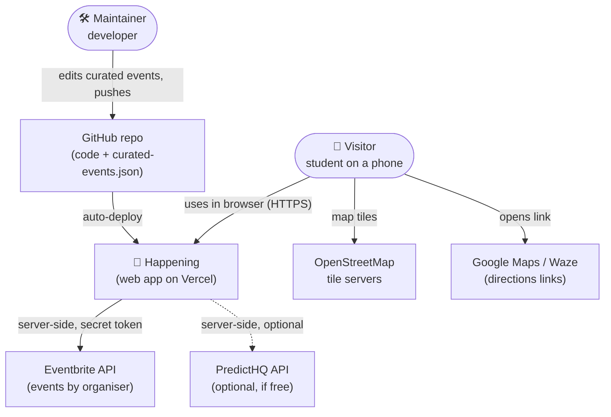
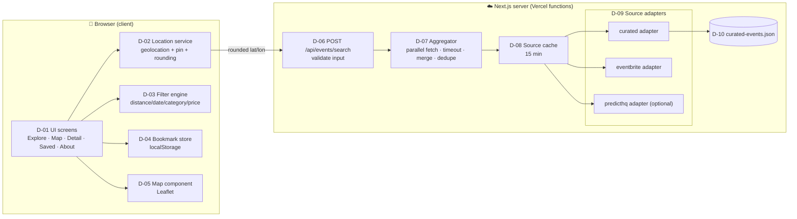
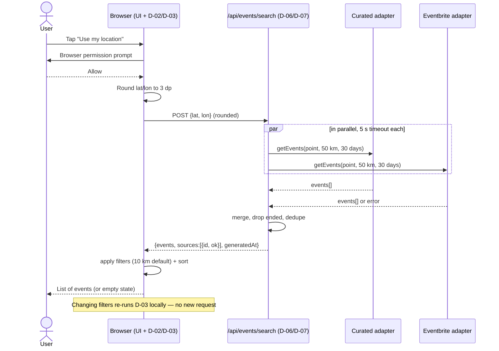

# Architecture — Happening

| Field | Value |
|---|---|
| Phase | 3 — Design |
| Version | 1.0 (draft for approval) |
| Date | 2026-11-11 |
| Product name | **Happening** (was "Events Near Me", see change log CR-01) |

> **What is a software architecture document?** It shows the big pieces of the system, how they
> talk to each other, and *why* they were chosen. Diagrams use the **C4 model** idea: start zoomed
> out (system context), then zoom in (containers, then components). Each design element has an ID
> (`D-xx`) so the traceability matrix can point to it.

## 1. Key decisions (Architecture Decision Records, short form)

| ADR | Decision | Options considered | Why this one |
|---|---|---|---|
| ADR-01 | **Next.js (App Router) + TypeScript** | React+Vite+Express; Flask+React | One project for pages *and* server code; server code keeps API keys secret (NFR-06); TypeScript catches errors early. Owner chose defaults. |
| ADR-02 | **Tailwind CSS** for styling | Plain CSS modules; component library (MUI) | Fast mobile-first layouts; included in `create-next-app`; small learning surface. |
| ADR-03 | **Leaflet + react-leaflet + OpenStreetMap tiles** | Google Maps; Mapbox | RM0, no key, no card (C-1). Must show OSM attribution (FR-32). |
| ADR-04 | **No database**; curated events in a JSON file in the repo, bookmarks in browser `localStorage` | Supabase/Postgres; Firebase | Nothing personal is stored on a server (privacy, NFR-10/11); zero ops; fits 80 h. Revisit only if user accounts are ever added. |
| ADR-05 | **Adapter pattern** for event sources | One big fetch function with `if` per source | Each source in its own file converting to one `Event` type → add/remove sources without touching UI (NFR-14). |
| ADR-06 | **Fetch once, filter on the device** | Server filters on every change | Server returns all events within **50 km** and **next 30 days** for a search point; the browser applies distance/date/category/price filters instantly (FR-14), with far fewer API calls (R-07). |
| ADR-07 | Search endpoint uses **POST with JSON body** | GET with `?lat=…&lon=…` | Hosting platforms log request URLs. Putting coordinates in the body keeps them out of URL logs (NFR-10). |
| ADR-08 | **Vercel Hobby** hosting, auto-deploy from GitHub | Netlify; Render | Made by the Next.js team, zero config, free HTTPS (NFR-07). Non-commercial use only **[verify]**. |
| ADR-09 | **Zod** for validating inputs and curated data | Hand-written checks | One schema both validates and produces TypeScript types (NFR-08, FR-25). |

## 2. System context (C4 level 1)



## 3. Containers and components (C4 levels 2–3)



### Component responsibilities

| ID | Component | Responsibility | Requirements |
|---|---|---|---|
| D-01 | UI screens | Screens, navigation, empty/error states, attribution | FR-06, FR-08, FR-15, FR-17, FR-18, FR-31, FR-32, NFR-03–05 |
| D-02 | Location service | Ask permission (with explanation), 10 s timeout, pin fallback, round to 3 dp | FR-01–03, NFR-09 |
| D-03 | Filter engine | Pure functions: distance (Haversine), date windows (Malaysia time), category, price, sort | FR-04, FR-05, FR-10–14, NFR-18 |
| D-04 | Bookmark store | Save/remove/list/clear bookmarks in `localStorage`; mark ended | FR-20, FR-21, NFR-11 |
| D-05 | Map component | Markers, summary card, search-point marker, OSM attribution | FR-07, FR-09, FR-32 |
| D-06 | Search API route | Validate body with Zod; return events + source status | FR-24, NFR-08, NFR-10 |
| D-07 | Aggregator | Call adapters in parallel, 5 s timeout each, keep successes, report failures, dedupe | FR-24, FR-28, FR-29, NFR-12 |
| D-08 | Source cache | Cache each live source's response ~15 min (key = source + search point rounded to 2 dp) | FR-30, NFR-01, R-07 |
| D-09 | Adapters | Convert source data → `Event`; map categories; drop ended events | FR-24–27, FR-05 |
| D-10 | Curated dataset | JSON file validated at build and at load | FR-25, NFR-19 |
| D-11 | Share & directions helpers | Web Share API / clipboard; Google Maps & Waze URLs | FR-19, FR-22 |
| D-12 | PWA manifest | Installable app metadata (Could) | FR-33 |

## 4. Main sequence — "show events near me"



A new request is made only when the **search point changes** (new location or pin moved).

## 5. External integrations

| Source | Access | Auth | Used for | Notes |
|---|---|---|---|---|
| Curated JSON | Read file at build/run | — | Baseline KL events (Must) | Owner adds events weekly; each must link to official page |
| Eventbrite | `GET /v3/organizers/{id}/events/?status=live&expand=venue,ticket_availability,category` — **confirmed working 2026-11-11** (no `page_size` param) | Private token in `Authorization: Bearer` header (server env var) | Live events (Should) | Organiser list in `EVENTBRITE_ORGANIZER_IDS`. Respect rate limits **[verify]** |
| PredictHQ | REST API with radius search **[verify]** | Token (server env var) | Live events (Could) | Built **only** if a free plan is confirmed; otherwise backlog |
| OpenStreetMap tiles | `https://tile.openstreetmap.org/{z}/{x}/{y}.png` from the browser | — | Map | Attribution required; light use only **[verify tile policy]** |
| Google Maps | URL `https://www.google.com/maps/dir/?api=1&destination=LAT,LON` | — | Directions (default) | No API key needed |
| Waze | URL `https://waze.com/ul?ll=LAT,LON&navigate=yes` **[verify]** | — | Directions (secondary link) | |

## 6. Caching strategy

| What | Where | How long | Why |
|---|---|---|---|
| Curated events | Bundled with the deployment | Until next deploy | It only changes when the owner edits the file |
| Live source responses | Server memory / Next.js data cache, key = source + point rounded to 2 dp (~1 km) | 15 min (configurable `SOURCE_CACHE_SECONDS`) | Fewer API calls (R-07), faster (NFR-01). Shortened if a provider's terms require (NFR-17) |
| Search results in the browser | React state | Until search point changes | Filters run locally (ADR-06) |
| Map tiles | Browser HTTP cache | Per OSM headers | Default behaviour |

On serverless hosting, memory caches are **best effort** (a cold start empties them). That's
acceptable: the cache saves calls but correctness never depends on it.

## 7. Error handling

| Situation | Behaviour | Req |
|---|---|---|
| A live source fails / times out | Show other sources' events + notice "Some sources are unavailable" | FR-28 |
| All live sources fail | Curated events still shown | NFR-12 |
| Invalid request body | HTTP 400 with a short message | NFR-08 |
| Location denied / >10 s | Switch to "tap the map to choose an area" | FR-02 |
| No events match | Empty state with "Widen radius" button | FR-15 |
| Event has no coordinates | Shown in list with label, not on map | FR-09 |
| Curated entry invalid | Skipped + warning in server log (no user data in log) | FR-25 |

## 8. Project structure (as built, Phase 4)

```
events-near-me/
├── data/curated-events.json            # D-10
├── src/
│   ├── app/
│   │   ├── page.tsx                    # Welcome + Explore (map + list sheet) (D-01)
│   │   ├── event/[id]/page.tsx         # Detail (server lookup per request)
│   │   ├── saved/page.tsx              # Saved (D-04)
│   │   ├── about/page.tsx              # Privacy & attribution
│   │   └── api/events/search/route.ts  # D-06
│   ├── components/                     # MapView (D-05), FilterSheet, EventRow, TabBar,
│   │                                   # EventActions (save/share), DistanceFromSearch, icons
│   └── lib/
│       ├── event-schema.ts             # Event type, Zod schemas, endTime/isEnded
│       ├── geo.ts  location.ts         # D-02
│       ├── filters.ts                  # D-03
│       ├── bookmarks.ts  use-bookmarks.ts   # D-04
│       ├── links.ts                    # D-11
│       ├── format.ts  categories.ts  search-point.ts
│       └── sources/                    # types, aggregator (D-07), registry, curated (D-09)
├── next.config.ts                      # security headers (§7 of security-privacy.md)
├── vitest.config.mts
└── .env.example
```
Tests sit next to the code (`*.test.ts`). Not built: `eventbrite.ts` (CR-03), source cache D-08 (only needed with a live source).

## 9. Default values and configuration

| Setting | Value | Where |
|---|---|---|
| Default map centre (no location yet) | Kuala Lumpur 3.1390, 101.6869, zoom 11 | constant (CR-02: only default, not a restriction) |
| Server search radius | 50 km | constant |
| Server search window | now → +30 days | constant |
| Default UI radius | 10 km | constant (FR-10) |
| Source timeout | 5 s | constant (FR-28) |
| Cache time | 900 s | env `SOURCE_CACHE_SECONDS` |
| Eventbrite token | secret | env `EVENTBRITE_TOKEN` |
| Eventbrite organisers | comma-separated IDs | env `EVENTBRITE_ORGANIZER_IDS` |
| Enabled sources | e.g. `curated,eventbrite` | env `ENABLED_SOURCES` |

## Approval

| Role | Name | Decision | Date |
|---|---|---|---|
| Developer / project owner | Project student | ☑ Approved (all Phase 3 design documents) | 2026-11-11 |
