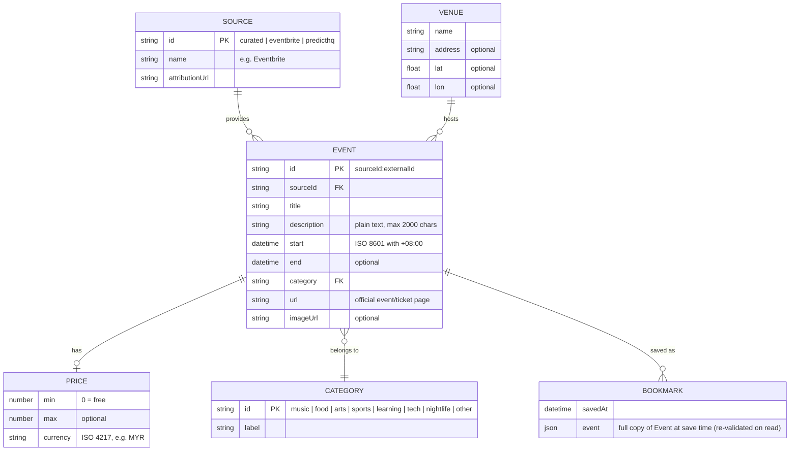

# Data Model — Happening

| Field | Value |
|---|---|
| Phase | 3 — Design |
| Version | 1.0 (draft for approval) |
| Date | 2026-11-11 |

> **What is a data model?** It describes the "things" the system deals with, their fields, and how
> they relate. An **ERD** (Entity-Relationship Diagram) draws this. We have **no database** (ADR-04),
> but we still need a model: it defines the shape every adapter must produce, the curated JSON
> format, and what's saved in the browser.

## 1. Entity-relationship diagram



*Venue and Price are **embedded** inside each Event (not separate tables) — the diagram separates
them only to show the structure.*

## 2. `Event` — the common format (D-09 output)

```ts
// src/lib/event-schema.ts (planned)
type CategoryId =
  | "music" | "food" | "arts" | "sports"
  | "learning" | "tech" | "nightlife" | "other";

interface Event {
  id: string;            // "curated:kl-0001", "eventbrite:123456789"
  sourceId: "curated" | "eventbrite" | "predicthq";
  title: string;
  description: string;   // plain text; HTML stripped
  start: string;         // ISO 8601, e.g. "2026-12-05T20:00:00+08:00"
  end?: string;
  venue: {
    name: string;
    address?: string;
    lat?: number;        // -90..90
    lon?: number;        // -180..180
  };
  category: CategoryId;
  price: {
    min: number;         // 0 means free
    max?: number;
    currency: string;    // "MYR" normally
  } | null;              // null = "Price not listed" (FR-13)
  url: string;           // official page — required (FR-18, FR-25)
  imageUrl?: string;
}

// Added by the browser, not stored:
interface EventWithDistance extends Event { distanceKm?: number }
```

| Field | Rule | Requirement |
|---|---|---|
| `id` | Unique; prefixed with source | FR-24, FR-29 |
| `start` / `end` | Must include timezone offset; displayed in Asia/Kuala_Lumpur | NFR-18 |
| `venue.lat/lon` | Optional; if missing → list only | FR-09 |
| `price` | `null` → "Price not listed"; `min = 0` → "Free"; non-MYR → show original currency | FR-13, FR-17, NFR-18 |
| `url` | Required, must be `https://` | FR-18, FR-25 |
| `description` | HTML stripped to avoid script injection | Security (see security-privacy.md) |

## 3. Categories

> Emoji were dropped in DC-01 (Night Map): categories show as text tags.

| ID | Label | Example source keywords mapped here |
|---|---|---|
| `music` | Music | concert, gig, festival (music), DJ |
| `food` | Food & Markets | food, market, bazaar, pasar malam, night market |
| `arts` | Arts & Culture | exhibition, theatre, film, museum, culture |
| `sports` | Sports | run, marathon, match, fitness, tournament |
| `learning` | Workshops & Learning | workshop, class, course, talk, seminar |
| `tech` | Tech & Meetups | meetup, hackathon, tech, startup, networking |
| `nightlife` | Nightlife | party, club, bar, night |
| `other` | Other | anything unmapped |

Mapping lives in `src/lib/sources/categories.ts`. Each adapter maps the source's own category
field first, then falls back to keyword matching on the title, then `other`.

## 4. Curated dataset format (D-10)

File: `data/curated-events.json` — an array of events in the `Event` shape **minus** `sourceId`
(it's always `curated`), with `id` written as `kl-0001`, `kl-0002`, …

Extra rules for curated entries (validated with Zod, FR-25):
- `url` is **required** and must point to the organiser's / venue's official page.
- `venue.lat` and `venue.lon` are **required** for curated events (you look them up once — see
  `curated-events-guide.md`).
- `price` must be set: `{ "min": 0, "currency": "MYR" }` for free, or `null` if unknown.
- Events whose `end` (or `start` if no end) is in the past are ignored automatically (FR-05).

Template: [`curated-events-template.json`](curated-events-template.json).

## 5. Search request / response (summary — full spec in `api-spec.md`)

```ts
interface SearchRequest  { lat: number; lon: number }        // rounded to 3 dp
interface SearchResponse {
  events: Event[];
  sources: { id: string; ok: boolean; count: number }[];
  generatedAt: string;
}
```

## 6. Browser storage (D-04)

| Key | Value | Purpose | Req |
|---|---|---|---|
| `happening.bookmarks.v1` | `{ savedAt, event }[]` (JSON) | Saved events, with a snapshot so they still show if the source drops them | FR-20, FR-21 |
| `happening.lastsearch.v1` | `{ savedAt, events }` (JSON) | Events from the last successful search, shown with a notice when the server can't be reached (offline mode). Public event data only | FR-40 |
| *(never stored)* | Location / pin coordinates | Privacy | NFR-09, NFR-10 |

The Privacy page "Clear saved data" button removes both stored keys (NFR-11). The `.v1` suffix lets us
change the format later without breaking old saved data.
