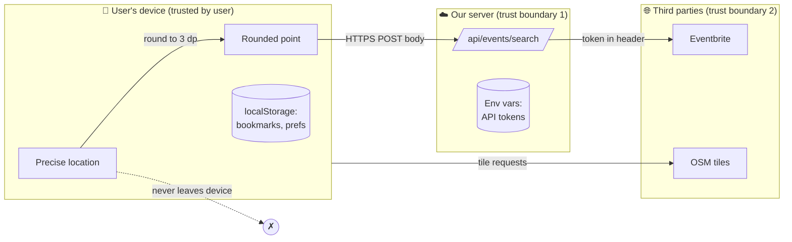
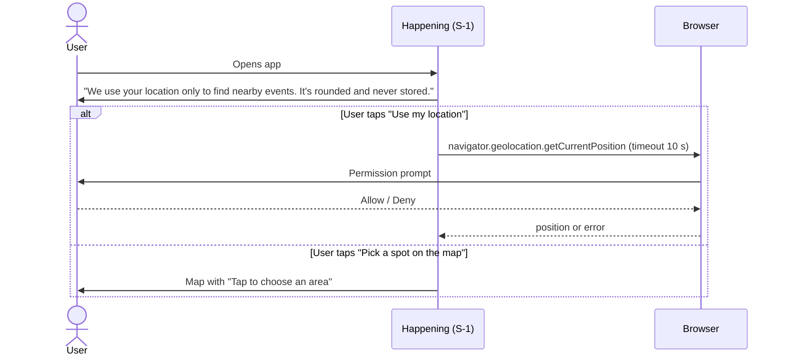

# Security & Privacy Design — Happening

| Field | Value |
|---|---|
| Phase | 3 — Design |
| Version | 1.0 (draft for approval) |
| Date | 2026-11-11 |

> **What is a threat model?** A structured way of asking "what could go wrong, security-wise?"
> before building. **STRIDE** is a checklist of six threat types: **S**poofing, **T**ampering,
> **R**epudiation, **I**nformation disclosure, **D**enial of service, **E**levation of privilege.
> For each, we note where it applies and how we defend against it. **Privacy by design** means
> privacy is built into the architecture, not bolted on later.

## 1. What we protect (assets)

| Asset | Why it matters |
|---|---|
| User's location | Personal data under PDPA; could reveal home/campus |
| API tokens (Eventbrite, PredictHQ) | Misuse could exhaust quota or get the account banned |
| Integrity of displayed event data | Users act on it (go places, buy tickets) |
| Availability of the app | Free tier quotas are small |

## 2. Data flow and trust boundaries



## 3. STRIDE-lite threat table

| # | Threat (STRIDE) | Where | Mitigation | Req |
|---|---|---|---|---|
| T-01 | **I**nformation disclosure — precise location leaked | Browser → server | Round to 3 dp (~100 m) on device; server re-rounds; POST body not URL (ADR-07); no logging of body; `Cache-Control: no-store` | NFR-09, NFR-10 |
| T-02 | **I**nformation disclosure — API token leaked | Repo, browser bundle | Tokens only in server env vars; never prefixed `NEXT_PUBLIC_`; `.env` git-ignored; `.env.example` has placeholders; GitHub secret scanning + push protection on | NFR-06, R-04 |
| T-03 | **T**ampering — malicious script in event description (XSS) | Event data from APIs | React escapes text by default; descriptions stored as **plain text** (HTML stripped); never use `dangerouslySetInnerHTML`; Content-Security-Policy header | Security |
| T-04 | **T**ampering — malicious link (`javascript:` URL) in event `url`/`imageUrl` | Event data | Zod requires `https://` URLs; external links use `rel="noopener noreferrer"` | FR-18 |
| T-05 | **T**ampering — invalid/huge input to API | `/api/events/search` | Zod schema, ranges, no extra fields, 1 KB body limit → 400/413 | NFR-08 |
| T-06 | **D**enial of service — someone spams the endpoint to burn API quota | Server | Source cache (15 min, ~1 km grid) means repeated calls rarely hit third parties; Vercel's platform limits; add simple per-IP rate limit if abuse seen (backlog) | FR-30, R-07 |
| T-07 | **D**enial of service — third-party slow/down | Aggregator | 5 s timeout per source; partial results | FR-28 |
| T-08 | **S**poofing — fake copy of the app | Hosting | HTTPS only; single canonical URL in README | NFR-07 |
| T-09 | **E**levation of privilege | — | Not applicable: no accounts, no admin UI. Curated data changes only via GitHub (owner's account — enable 2FA) | — |
| T-10 | **R**epudiation | — | Low relevance (no user actions on server). Git history records who changed curated data | — |
| T-11 | Supply chain — vulnerable npm package | Dependencies | Dependabot alerts; `npm audit` in CI; few dependencies | Maintenance |

## 4. Location consent flow (PDPA principles)

| PDPA principle **[verify wording against current Act]** | How Happening applies it |
|---|---|
| General / consent | Explain purpose **before** the browser prompt; the user taps to start; pin option if they decline |
| Notice and choice | Welcome screen sentence + Privacy page (FR-31) |
| Disclosure | Rounded point is sent only to our server; never to third parties except as a search area if a live API needs it (Eventbrite adapter filters on our server, so it doesn't) |
| Security | HTTPS; no storage of location |
| Retention | Location kept only in memory for the current session; not written to `localStorage` or any server |
| Data integrity | N/A — not stored |
| Access | Nothing about the user is stored server-side; device data clearable from Privacy page |



## 5. Privacy page content (FR-31) — outline

1. What we use: your location **or** a spot you pick, rounded to about 100 m.
2. Why: only to find events near that point.
3. What we keep: nothing on our servers. Your bookmarks and filter choices stay on this device.
4. Who else: event sources (Eventbrite etc.) are queried by our server, not with your location
   details; map images come from OpenStreetMap, which sees your IP address like any website.
5. Control: "Clear saved data" button; you can turn off location in your browser at any time.
6. Contact: project repository link.

## 6. Secret handling

| Rule | How |
|---|---|
| Secrets never in Git | `.gitignore` covers `.env*` except `.env.example` (already in repo) |
| Local development | Copy `.env.example` → `.env.local`, fill in real values |
| Production | Set in Vercel project → Settings → Environment Variables |
| Server-only | Read with `process.env.X` inside API route / server code only; **never** `NEXT_PUBLIC_` prefix |
| Detection | Enable GitHub secret scanning & push protection **[verify availability for private repos on your plan]** |
| If leaked | Revoke in provider dashboard → create new token → update Vercel env → redeploy → note in maintenance log |

### `.env.example` (planned)
```bash
# Comma-separated list of sources to use
ENABLED_SOURCES=curated,eventbrite
# Eventbrite private token (server only — never commit the real value)
EVENTBRITE_TOKEN=replace-me
# Comma-separated Eventbrite organiser IDs to pull events from
EVENTBRITE_ORGANIZER_IDS=
# Live-source cache time in seconds
SOURCE_CACHE_SECONDS=900
```

## 7. Security headers (set in `next.config`)

| Header | Value (summary) |
|---|---|
| `Content-Security-Policy` | default `'self'`; images from `self`, OSM tiles, event image hosts; no inline scripts except Next.js needs **[tune in Phase 4]** |
| `Referrer-Policy` | `strict-origin-when-cross-origin` |
| `X-Content-Type-Options` | `nosniff` |
| `Permissions-Policy` | `geolocation=(self)`, camera/microphone disabled |
| `Strict-Transport-Security` | Provided by Vercel on HTTPS **[verify]** |
