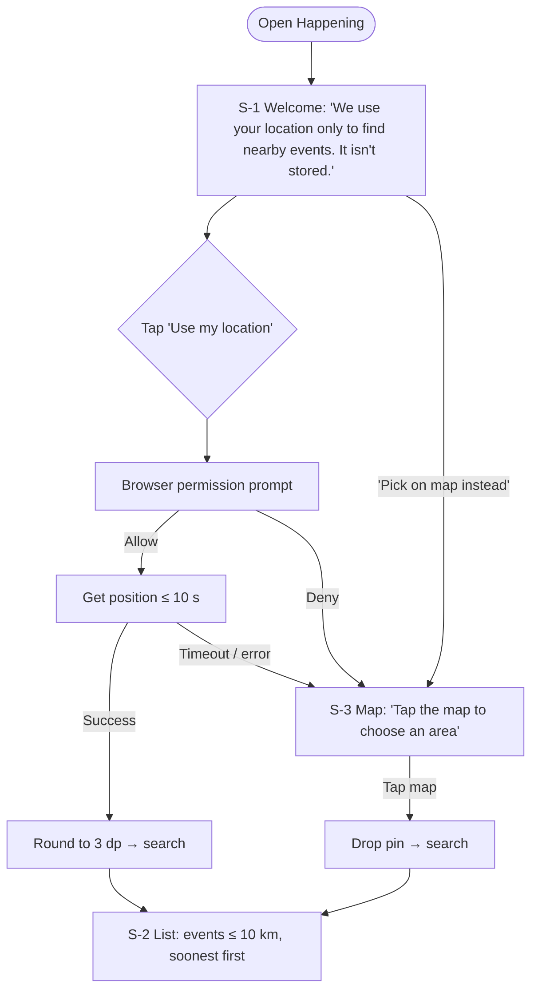
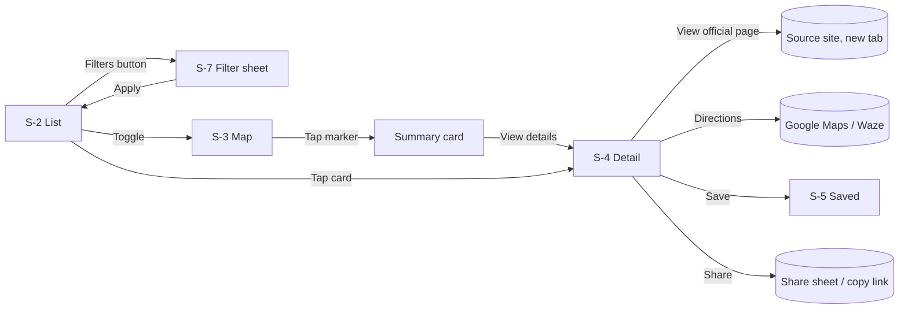

# UI / UX Design — Happening

| Field | Value |
|---|---|
| Phase | 3 — Design |
| Version | 1.1 — style changed to Night Map (DC-01, 2026-11-11) |
| Date | 2026-11-11 |
| Style | **Night Map**: map-first Explore with a list sheet, dark-first with a light mode, lime accent, line icons (was: playful campus) |

> **What's in a UI/UX design doc?** *UX* (user experience) is how the app flows — what the user does
> step by step. *UI* (user interface) is how each screen looks. Standard artefacts: **user flows**
> (diagrams of paths through the app), **wireframes** (low-detail screen sketches), and a **style
> guide** (colours, type, components). Design **mobile-first**: sketch the small screen, then
> stretch it.

## 1. Navigation and screens

| ID | Screen | Purpose | Requirements |
|---|---|---|---|
| S-1 | Welcome / location prompt | Explain why location is needed, then ask | FR-01, US-10 |
| S-2 | Explore — List | Results list + filter bar | FR-04–06, FR-10–15 |
| S-3 | Explore — Map | Markers, pin dropping, summary card | FR-02, FR-03, FR-07, FR-09 |
| S-4 | Event detail | All details + actions | FR-17–20, FR-22 |
| S-5 | Saved | Bookmarked events | FR-20, FR-21 |
| S-6 | About & Privacy | Privacy notice, attribution, clear data | FR-31, FR-32, NFR-11 |
| S-7 | Filter sheet | Distance, date, category, price, sort | FR-10–14 |

Bottom tab bar (thumb-friendly): **🔍 Explore · 🔖 Saved · ℹ️ About**. List/Map is a toggle inside Explore.

## 2. User flows

### Flow A — First visit (FR-01, FR-02)



### Flow B — Find, filter, act (FR-10–22)



## 3. Wireframes (360 px wide, low-fidelity)

> **Superseded by DC-01 (Night Map).** The low-fidelity wireframes below are kept as the Phase 3
> record. The current screens are the Night Map mock-ups (canvas linked in §4) and the built
> screenshots in `docs/04-implementation/screenshots/slice2-*`. Main differences: Explore shows the
> map and the list together (no List/Map toggle), pins are dots with the selected pin labelled, and
> categories are text tags instead of emoji.

### S-1 Welcome
```
┌────────────────────────────────┐
│            🎉                  │
│         Happening              │
│  Find what's on near you —     │
│  gigs, markets, workshops,     │
│  meetups & more.               │
│                                │
│  📍 We use your location only  │
│  to find nearby events. It's   │
│  rounded and never stored.     │
│                                │
│ ┌────────────────────────────┐ │
│ │   📍 Use my location       │ │  ← primary button (≥44 px tall)
│ └────────────────────────────┘ │
│     Pick a spot on the map     │  ← secondary text button
│                                │
│      Privacy · About           │
└────────────────────────────────┘
```

### S-2 Explore — List
```
┌────────────────────────────────┐
│ 🎉 Happening        [List|Map] │
│ 📍 Near you · 10 km  ✏️ change │
│ ┌──────┐┌────────┐┌─────────┐  │
│ │Next30d││All cats││⚙ Filters│ │  ← chips (scroll sideways)
│ └──────┘└────────┘└─────────┘  │
│ 23 events · Sort: Soonest ▾    │
│ ┌────────────────────────────┐ │
│ │ [img]  🎵 MUSIC            │ │
│ │ Indie Night at …           │ │
│ │ Fri 4 Dec · 8:00 PM        │ │
│ │ 📍 Venue name · 2.4 km     │ │
│ │ RM 35.00            🔖     │ │
│ └────────────────────────────┘ │
│ ┌────────────────────────────┐ │
│ │ [img]  🍜 FOOD & MARKETS   │ │
│ │ Weekend Craft Market       │ │
│ │ Sat 5 Dec · 10:00 AM       │ │
│ │ 📍 Venue · 4.1 km    FREE  │ │
│ └────────────────────────────┘ │
│ ⚠ Some sources are unavailable │  ← only when FR-28 applies
├────────────────────────────────┤
│  🔍 Explore   🔖 Saved  ℹ️ About │
└────────────────────────────────┘
```

### S-3 Explore — Map
```
┌────────────────────────────────┐
│ 🎉 Happening        [List|Map] │
│ ┌────────────────────────────┐ │
│ │        🎵      🍜           │ │
│ │   ⚽        📍(you/pin)     │ │
│ │        🎨          💻       │ │
│ │  (tap anywhere to move pin)│ │
│ │ ┌────────────────────────┐ │ │
│ │ │ 🍜 Weekend Craft Market│ │ │  ← summary card on marker tap
│ │ │ Sat 5 Dec · FREE       │ │ │
│ │ │ [ View details → ]     │ │ │
│ │ └────────────────────────┘ │ │
│ └──────────── © OpenStreetMap┘ │
│ 3 events not shown on map (no  │
│ location) — see list           │  ← FR-09
├────────────────────────────────┤
│  🔍 Explore   🔖 Saved  ℹ️ About │
└────────────────────────────────┘
```

### S-4 Event detail
```
┌────────────────────────────────┐
│ ← Back                  🔖  ↗  │  ← save, share
│ ┌────────────────────────────┐ │
│ │          [image]           │ │
│ └────────────────────────────┘ │
│ 🍜 FOOD & MARKETS              │
│ Weekend Craft Market           │
│ 🗓 Sat 5 Dec 2026              │
│    10:00 AM – 6:00 PM (MYT)    │
│ 📍 Venue name                  │
│    Full address · 4.1 km       │
│ 💸 Free                        │
│ About this event               │
│ Lorem description text …       │
│                                │
│ ┌────────────────────────────┐ │
│ │ 🧭 Directions (Google Maps)│ │
│ └────────────────────────────┘ │
│ ┌────────────────────────────┐ │
│ │ 🎟 View official page  ↗   │ │
│ └────────────────────────────┘ │
│      Open in Waze instead      │
│ Source: Curated by Happening   │
└────────────────────────────────┘
```

### S-5 Saved
```
┌────────────────────────────────┐
│ 🔖 Saved (3)                   │
│ ┌────────────────────────────┐ │
│ │ 🎵 Indie Night at …   🔖   │ │
│ │ Fri 4 Dec · RM 35.00       │ │
│ └────────────────────────────┘ │
│ ┌────────────────────────────┐ │
│ │ 🎨 Art Exhibition   ENDED  │ │  ← FR-21, greyed out
│ └────────────────────────────┘ │
│ Empty state: "Nothing saved    │
│ yet — tap 🔖 on any event."    │
├────────────────────────────────┤
│  🔍 Explore   🔖 Saved  ℹ️ About │
└────────────────────────────────┘
```

### S-7 Filter sheet (slides up from bottom)
```
┌────────────────────────────────┐
│ Filters                 Reset  │
│ Distance                       │
│ (2) (5) [10] (25) (50) km      │
│ When                           │
│ (Today) (This weekend)         │
│ (Next 7 days) [Next 30 days]   │
│ Category                       │
│ [🎵 Music] [🍜 Food] [🎨 Arts]  │
│ [⚽ Sports] [📚 Learning]       │
│ [💻 Tech] [🌙 Nightlife] [✨]   │
│ Price                          │
│ [All] (Free only) (Max RM __)  │
│ Sort: (Soonest) (Nearest)      │
│ ┌────────────────────────────┐ │
│ │      Show 23 events        │ │  ← live count
│ └────────────────────────────┘ │
└────────────────────────────────┘
```

## 4. Style guide — "Night Map" (DC-01, replaces "playful campus")

> **Design change DC-01 (2026-11-11):** the owner chose direction **B · Night Map** from three
> options (canvas: claude.ai/artifact/VGcwHwxsvoxUWtDnRioEYU). It replaces the Phase 3
> "playful campus" look. No requirement changes; FR/NFR stay as approved. Built with Slice 2.

### Layout idea
- **Explore = map on top, list in a sheet below** (one screen instead of a List/Map toggle).
  The sheet can be dragged up to read the list full-height; the map is never the only way to
  reach an event (the list always has every event — NFR-05).
- Search-area field + **Filters** button float over the top of the map.
- Bottom tab bar is a floating rounded bar: **Explore · Saved · About**.
- List rows are compact: date block (day + month) · title · time · venue · distance · price tag.
- **Quick chip (FR-34, CR-04):** a "Free this week" chip sits under the list heading. Off = outlined
  (`--line` border on `--surface`); on = lime fill with ink text **plus a check icon** (state is never
  colour alone) and `aria-pressed`. Button radius 14 px, at least 44 px tall.
- **Chip row (FR-36, CR-06):** "Today" and "Free this week" sit side by side (wrapping on narrow phones, 8 px
  gap) and use the same chip style. They can be on together; "Today" only sets the date.
- **Search box (FR-35, CR-05):** a full-width field under the heading (`--surface` fill, `--line` border, 14 px
  radius, 44 px tall, search icon on the left, a visually hidden "Search events" label). Typing narrows the list
  live; the empty state suggests "a different search". The filter sheet's Reset does not clear it.

### Colour tokens (contrast measured 2026-11-11)

| Token | Dark (default look) | Light | Use | Contrast |
|---|---|---|---|---|
| `--bg` | `#0E0F13` | `#F7F7F5` | Page / sheet background | — |
| `--map` | `#16181F` | `#E9EAE6` | Map area while tiles load | — |
| `--surface` | `#1C1E26` | `#FFFFFF` | Tab bar, inputs, cards | — |
| `--line` | `#2E313B` | `#DCDDD8` | Borders, row dividers | — |
| `--text` | `#F4F4F5` | `#0E0F13` | Body text | 17.4 / 17.9 ✅ |
| `--text-muted` | `#A1A1AA` | `#52525B` | Secondary text | 7.5 (6.5 on surface) / 7.2 ✅ |
| `--accent` | `#C6F432` (lime) | `#C6F432` | **Fills only**: Filters button, FREE tag, current pin | ink `#0E0F13` on lime 14.9 ✅ |
| `--accent-text` | `#C6F432` | `#4D7C0F` | Accent-coloured **text**/icons (active tab, links) | 14.9 / 5.0 on white, 4.7 on bg ✅ |
| `--warning` | `#FBBF24` | `#B45309` | "Some sources unavailable" | ✅ both |

Rule: lime is never used as text on a light background (it fails contrast); use `--accent-text`.

### Theme
Follows the phone's setting (`prefers-color-scheme`). Dark is the signature look in mock-ups;
light mode uses the same layout with the light tokens.

### Typography
- Headings and date numbers: **Space Grotesk** 500/700. Body: **Inter** 400/500/600.
  Both via `next/font/google`.
- Sizes: body 15–16 px (never below 12 px for tags), row title 15 px semibold, sheet title 24 px bold.

### Icons, shapes and motion
- **Line icons** (inline SVG, 2 px stroke, `aria-hidden`), no emoji. Categories shown as text
  tags; colour is never the only signal (WCAG 1.4.1).
- Radii: sheet top 26 px, tab bar 20 px, inputs/buttons 14 px, tags 8 px.
- Motion: only the sheet slide and pin highlight; all off with **reduced motion**.

### Map
- Leaflet + OpenStreetMap tiles (ADR-03). In dark theme the tiles are dimmed with a CSS filter
  so the screen stays dark; attribution "© OpenStreetMap contributors" always visible (FR-32).
- Pins are labelled chips (event short name), the search point is a lime dot with a halo.

## 5. Content and formatting rules (NFR-18)

| Item | Format | Example |
|---|---|---|
| Date | `EEE d MMM` (+ year if not this year) | Sat 5 Dec |
| Time | 12-hour, Malaysia time | 8:00 PM |
| Price | `RM 0.00`; free → `FREE` badge; null → "Price not listed" | RM 35.00 |
| Price range | `RM min – RM max` | RM 20.00 – RM 80.00 |
| Non-MYR | Original currency, no conversion | USD 15.00 |
| Distance | 1 decimal km | 2.4 km |

## 6. Accessibility checklist (NFR-05)

- [ ] Text contrast ≥ 4.5:1 (≥ 3:1 for large text and icons)
- [ ] Tap targets ≥ 44 × 44 px
- [ ] Every control reachable by keyboard with a visible focus ring
- [ ] Images have `alt` text (event title); decorative emoji hidden from screen readers or labelled
- [ ] Map markers also available as the list (map is never the only way to reach an event)
- [ ] Status messages (results count, "Link copied", errors) announced with `aria-live`
- [ ] Page zoom to 200 % without loss of content
- [ ] Reduced-motion respected
- [ ] Semantic headings (`h1` per screen) and landmarks (`nav`, `main`)

## 7. Directions behaviour (FR-19, decided Phase 3)
Primary button opens **Google Maps** (works on phone and desktop). A smaller "Open in Waze
instead" link sits underneath. (Not remembered between visits — saved preferences dropped 2026-11-11.)
